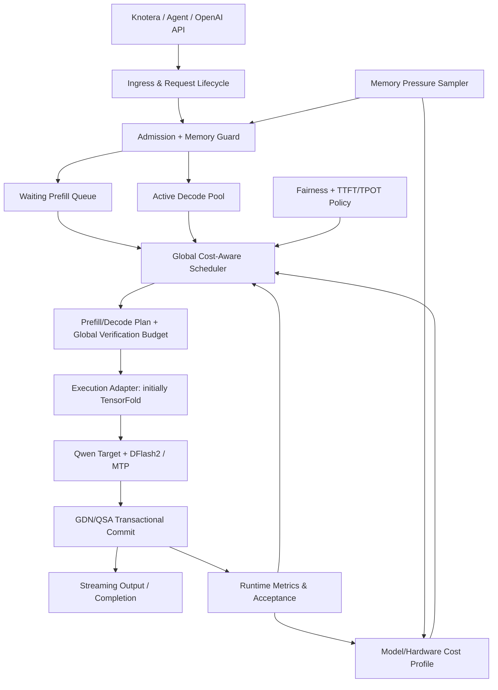

# Global Cost-Aware Scheduler：DGX Spark 全局推理调度设计（RFC v0.1）

> **状态：PROPOSED / 设计文档，未实现或验证全局调度。**  
> 面向：单台 NVIDIA DGX Spark（GB10 / SM121）、Qwen3.8-Flash-Next、DFlash2、DeepInfer-derived MTPVarlen。  
> 日期：2026-10-20；2026-10-22 按 `main` @ `51828be`（E4–E16 已合入）核对事实，并相应修订证据、约束和阶段状态。用途：评审接口、实验和实施顺序；**不是**性能成果报告。
>
> 历史范围：本 RFC 的 2026-10-22 快照没有预先选择最终底座。2026-10-24 用户已明确后续采用 **DeepInfer 调度底座 + 自有 Qwen/Spark 执行后端**，TensorFold 作为过渡适配与参考；见[当前实施方向](DEEPINFER_OWN_BACKEND_PLAN.md)。下文实现状态和非目标保留当时快照，不作为当前 K4 状态；最新结果见 [K4 联合预算报告](K4_JOINT_BUDGET_REPORT.md)。

## 0. 摘要和核心判断

现有 SparkInfer-Q 已将 **TensorFold Qwen target 执行路径 + DFlash2 草稿 + DeepInfer 原生 MTPVarlen 预算器**联通，并完成单请求、有界 greedy 实验（E16 覆盖选定的 1K/1.5K 输入）。E5 已让原生 DeepInfer C++ Scheduler 驱动有界的 target-only 请求生命周期，但 GPU 仍逐个请求执行；目前没有多请求 GPU batch，也没有可用的全局在线服务。

本提案的主要增量不是另写一个逐请求 `choose_width()`，而是增加一个**跨请求资源决策层**，统一管理：

1. 多请求目标模型验证预算：每个请求本轮验证多少草稿、总 CUDA Graph token bucket 选多大；
2. Prefill 与 Decode 竞争：交互请求的 TPOT 与后台长输入的进度协调；
3. 统一内存和状态预算：新请求准入、KV / GDN 状态容量、草稿与缓存的内存压力；
4. 调度模式：无推测、固定 MTP、DFlash2 动态预算的选择与回退；
5. 异步执行反馈：将实际耗时、接受率、排队时间和容量告警反馈给成本模型。

**成功条件**是同机、同模型、同精度/协议下，端到端实际指标优于强基线，且不破坏 token、GDN/QSA 状态、取消与恢复语义。**失败也应如实保留**：单路动态预算不必优于校准后的固定草稿长度。

## 1. 已有证据（必须与目标状态区分）

以仓库当前 `main` 的实验记录为准：

| 当前模块或证据 | 已经完成 | 不能推导的结论 |
| --- | --- | --- |
| `spark_infer_q/verification_budget.py` | 滞后接受率统计 | 不是跨请求在线调度 |
| `scripts/e3_varlen_bindings.cpp` | 薄绑定复用 DeepInfer 原生 `MTPVarlen` | 不是完整 DeepInfer Scheduler |
| `scripts/e3_wide_work.py` | 单请求调用 `BudgetProbe.schedule(..., [entry(...)])`，八行 / 最多七草稿 | 尚未执行多个请求的联合 GPU 验证 |
| `spark_infer_q/local_policy.py` | 三草稿的前置启停、后置选长度实验策略 | 尚未与七草稿全局策略联合 |
| `spark_infer_q/confidence_head.py`（E15/E16） | 七深度后置置信头，输出 MTPVarlen 使用的累积接受率；`choose_rows` 是单请求选宽规则，`headroom_capture` 用 Dinkelbach 迭代求总 token / 总耗时的离线 oracle | 只在单请求上训练和验证；多请求下的成本没有测过 |
| `spark_infer_q/executor.py` | 最小化请求生命周期、句柄、状态快照原型 | 尚未桥接完整 Qwen 服务执行器 |
| `spark_infer_q/deepinfer_bridge.py`（E5） | 原生 DeepInfer C++ Scheduler 驱动有界 Qwen target-only 生命周期；原生 block 只作逻辑配额 | GPU 仍逐请求执行；没有 Worker、异步流水或推测解码接线 |
| `spark_infer_q/moe_cost.py`（E12） | 每层 Top-10 路由的专家并集；本轮真实并集让离线成本 MAE 降 26.17%，只用上一轮并集仅降 2.42% | 真实并集要验证后才知道，不能在线使用；同前缀预算诊断最多 +1.28%，不是 decode 提速 |
| `docs/E3_WIDE_BLOCK_REPORT.md` | 受控 greedy 实验：主实验动态 43.10 tok/s、fixed7 41.50 tok/s | 独立匹配对照里 dynamic 42.21、校准 fixed6 42.20：按深度滞后先验的动态增益没有建立 |
| `docs/E4_MATCHED_REPORT.md` | 短上下文同机对照：dynamic 47.37 vs fixed6/fixed7 46.39/46.30 tok/s（+2.12%/+2.31%） | 只覆盖 TensorFold 路径；vLLM/SGLang、并发、长上下文未测 |
| `docs/E7_TENSORFOLD_MATCH_REPORT.md`、`docs/E8_INTEGRATION_REPORT.md` | E7 预热后整体 45.62 vs 原生 MTP 49.18 decode tok/s；E8 把 TTFT 中位数之和从 19.69 秒降到 4.23 秒，decode 45.91→45.39 | E8 之后没有重测原生 TensorFold，没有整体领先结论 |
| `docs/E9_DECODE_PROFILE_REPORT.md` | target 验证占 decode 的 83.81%，草稿占 14.39% | GPU 活动覆盖率不是 SM 或 DRAM 利用率 |
| `docs/E13_DRAFT_CACHE_CONFIDENCE_REPORT.md` | 草稿上下文增量缓存：1K–2K 输入 +6.27%，短输入 −0.31%，默认不变 | 4K 以上要先处理滑窗 |
| `docs/E14_CONFIDENCE_BUDGET_REPORT.md` | 在线 margin 预算 +0.065%，区间跨零；冻结成本下 32 个分桶组合都选 anchor+5 | 深度先验让 MTPVarlen 的选择几乎不随输入变化 |
| `docs/E15_CONFIDENCE_TRAINING_REPORT.md`、`docs/E16_BILINGUAL_EXPANSION_REPORT.md` | 冻结新任务上，E15 相对滞后预算 +10.00%、相对固定七草稿 +10.88%；E16 的 20 个中英文任务相对滞后预算 +9.61%（耗时下降区间 7.38%–10.46%） | 单请求、greedy、opt-in；没有 4K 以上、随机采样、多请求或默认切换 |

**当前显著限制：**仅受控 greedy；上下文最多覆盖选定的 1K–2K 输入，4K 以上未测。官方 DFlash2 的 BF16 数值差异与 target prefill 数值参考都还没关闭（[草稿 fidelity](DRAFT_FIDELITY_ACCEPTANCE_PLAN.md)和 [prefill 数值参考](PREFILL_REFERENCE_PLAN.md)两份方案都未执行）。随机采样、多请求、真实服务级 TTFT/TPOT 尚无验收结论。此 RFC 不改变这些状态。

## 2. 目标、非目标与产品约束

### 目标

- **多租户同模型：**第一版只管理同一 Qwen target 的 1/2/4/5 个活跃请求，不复制多个主模型进程。
- **吞吐与延迟并重：**保持前台对话连续输出，后台 Agent 文档/代码任务利用剩余容量；按服务等级约束 TTFT / TPOT。
- **状态严格隔离：**每个请求有独立的 GDN recurrent/conv 状态、QSA KV/index、DFlash proposer 上下文与 EOS/采样状态。
- **算法可替换：**先保留现有 TensorFold 执行器作为研究适配；抽象控制面，使未来可评估完整 DeepInfer / vLLM / SGLang 接入。
- **可退化：**无法预测、性能数据缺失或内存压力过大时退回可验证的固定策略，并保持请求状态正确。

### 非目标（v0.1）

- 重写 Qwen 的核心 GPU kernels；接受率直接用 E15/E16 已训练的置信头，本 RFC 不另训新头；
- 直接宣称完整 DeepInfer 适配或生产可用；
- 跨主机并行、MoE EP 集群负载平衡；
- 在未证明正确性的情况下支持随机采样、GPU ragged GDN/QSA；
- 将 Linux 统一内存页面换入换出视作调度器可以完全控制的能力。

## 3. 分层架构



**控制面（可慢）**：请求准入、优先级与公平性、内存水位、负载类别、模型模式。  
**逐 step 关键路径（必须轻）**：选择 Prefill/Decode 作业、选择验证总预算/图 bucket、打包设备 metadata、dispatch。  
**执行面（必须正确）**：target Forward、草稿/校验、GDN/QSA accepted-prefix commit、token 流输出和取消清理。

最先只做 **Decode-only 多请求调度**；Prefill 混合与资源/模式调度单独增加，防止把全部变量混在一次性能实验里。

### 建议工程模块（仅目录提案，不代表存在）

- `spark_infer_q/global_scheduler/requests.py`：请求阶段、句柄、代次、优先级、剩余 token。
- `spark_infer_q/global_scheduler/admission.py`：内存水位与准入 / 排队 / 拒绝。
- `spark_infer_q/global_scheduler/cost_model.py`：按图 bucket、并发、上下文分层的校准曲线。
- `spark_infer_q/global_scheduler/verify_budget.py`：跨请求预算分配；适配已有 DeepInfer MTPVarlen。
- `spark_infer_q/global_scheduler/phase_policy.py`：chunked prefill、decode 配额、避免饥饿。
- `spark_infer_q/global_scheduler/metrics.py`：非阻塞收集、低频校准和模式回退。
- `spark_infer_q/integrations/tensorfold/`：初期执行适配，后续有证据再抽换。

## 4. 必要的数据契约

以下为接口示意，**不是可以直接执行的代码**。

```python
@dataclass(frozen=True)
class RequestSnapshot:
    request_id: str
    generation: int         # slot 复用防止过期结果
    phase: Literal["waiting_prefill", "prefill", "decode", "done", "cancelled"]
    priority_weight: float  # > 0
    enqueue_ns: int
    deadline_ns: int | None
    context_tokens: int
    remaining_tokens: int
    committed_position: int # 已真正由 target 处理并提交的 token 位置
    pending_token_id: int | None
    state_handle: object    # GDN/QSA 的受控句柄，控制面不直接改 GPU tensor
    draft_max_k: int        # 当前 proposer/内核已验证支持的上限

@dataclass(frozen=True)
class CostSnapshot:
    engine_revision: str
    model_revision: str
    quantization: str
    context_bucket: int
    active_requests: int
    graph_cost_ms: dict[int, float]     # 真实测出的 CUDA Graph bucket 耗时
    draft_cost_ms: dict[str, float]    # proposer 模式与草稿布局
    state_commit_ms: float
    measurement_confidence: float
    pressure_level: Literal["normal", "guarded", "critical"]

@dataclass(frozen=True)
class SchedulePlan:
    selected_request_ids: tuple[str, ...]
    phase: Literal["prefill", "decode"]
    query_lengths: tuple[int, ...]     # decode: 每个请求 >= 1，且先选 anchor
    graph_bucket: int
    modes: tuple[str, ...]             # disabled / mtp / dflash2，初期按批保持一致
    expected_committed_positions: tuple[int, ...]
    state_generations: tuple[int, ...]
```

执行适配需要公开能力标志（如 supports_batched_verify、supports_ragged_gdn、supports_ragged_qsa、supports_chunked_prefill、supports_cuda_graph_bucket）；**能力未验证为 true 时不得调度到该路径**。v0.1 的确切执行接口应在 G1 最小适配试验中确定，避免凭空复用原始 V4.1 的 metadata。

### 请求生命周期

`WAITING_PREFILL → PREFILL → DECODE → FINISHED`，另外允许在安全点 `CANCELLED`。实际 state 句柄需携带 request ID、slot generation、已提交位置和本次 dispatch epoch；任何完成通知都检查代次。

一次 speculative step 可能输出 correction/bonus token，但该 token 尚未经过下一次 target forward：**已输出 token 数 ≠ 已提交 target 状态位置**。只可提交有效 accepted prefix；被拒绝的 GDN 影响不能靠单纯删除 KV 处理，需从合法状态快照恢复/重放。

## 5. 两级调度

### Level A：低频全局资源决策

观察队列、SLO、峰值状态/缓存、正在运行的任务、温度/时钟等可观测条件：

1. 内存 admission：估计新增请求的 KV、GDN、draft state、graph scratch 和可增长余量；超过预算则排队或拒绝新任务；
2. 阶段调度：决定下一段 GPU 时间用于 Decode，还是切出一个有界 Prefill chunk；不要让长 Prefill 无限阻塞已有流；
3. 工作优先级：前台交互较低延迟预算，后台批处理较高吞吐目标；防止低优先级永久饥饿；
4. 推理模式：可以选择不启用草稿 / 原生 MTP / DFlash2，但最初按 batch 或请求生命周期稳定选择，避免逐 token 切换带来的 graph/state 成本；
5. 保护策略：检测资源压力或统计漂移，允许限制新任务与降低最大并发，**但不能跳过已提交状态的正确性检查**。

### Level B：逐 Decode step 的联合验证预算

设活跃 Decode 请求数为 n，第 i 个请求最多可验证 K_i 个草稿；k_i = 0 表示 target-only 的 anchor 行。本轮实际 query 总行数：

```text
Q = sum_i (1 + k_i),      0 <= k_i <= K_i
GraphBucket = smallest supported captured bucket >= Q
```

若第 i 个请求的第 j 个**条件**接受概率为 p[i,j]，则草稿前缀存活概率：

```text
s[i,j] = product_{h=1..j} p[i,h]
E_i(k_i) = 1 + sum_{j=1..k_i} s[i,j]  # 简化的期望有效输出/步
```

总预算不应机械地平分。用离散图 bucket 上的成本曲线枚举候选 Q，再寻找使下式最大的合法长度：

```text
utility = sum_i weight_i * E_i(k_i) / estimated_step_ms(bucket, state, memory)
constraints:
    Q <= supported_bucket_capacity
    0 <= k_i <= K_i
    every selected request gets an anchor
    prefix continuity; no verifying draft j without earlier drafts
    fairness, deadline and memory safety constraints
```

初期采用 DeepInfer 原生 MTPVarlen 的策略作为 baseline；可选实现逐 bucket 前缀增益排序。**每个请求 s[i,j] 随 j 不增**时，基于增量收益的排序天然满足前缀约束；加入 EOS、动态草稿成本、优先级变化或非可加状态成本时，则需受约束 DP/小规模枚举，并用 host-only 穷举 oracle 校验。

**接受率从哪里来（2026-10-22 更新）：**单请求上已有实测。E14 表明只按深度的滞后先验几乎不随输入变化：冻结成本下 32 个分桶组合都选 anchor+5，在线 margin 策略没有确认的提速。E15/E16 训练的七深度置信头（`confidence_head.py`）直接输出累积率 s[i,j]，在冻结的新任务上比滞后预算快约 10%。多请求时应把这些头的输出作为 s[i,j]。只要 G2 的批处理保持每个请求的 greedy 输出不变，这些接受率就可以沿用；需要重测的是 batch 后的成本曲线。这些头是后置信号，要等草稿生成后才有，按下一段的规则计入已付的草稿成本。

重要：DFlash2 如果已生成完整八行草稿，后置选择 k_i 更短**并不会退还该次 draft cost**。草稿前选择使用尚未支付的预估成本，草稿后选择必须把已经支付的成本加入所有候选；不能把这两种决策混为一个。

DeepInfer 原生 MTPVarlen 采用历史接受率和实际成本，考虑 N−2 / N−1 的滞后关系。E15/E16 的在线路径没有沿用这种滞后：它在草稿后把特征传回 CPU 预测，传输和预测都计入了耗时，结果仍快约 10%。所以多请求时不必禁止这类同步，但必须把它计入成本，并在 batch 下重新测量，不能假设它在多个请求时仍然便宜。未来在 GPU varlen 路径就绪时，再引入实际 ragged query metadata；初期先由确定正确的 host-side 计划驱动执行。

## 6. Spark 专用成本模型

**不要先写一个理论内存带宽公式作为线上真值。** 直接测量相同权重/量化、上下文段、graph bucket、并发规模和内存压力下的实际耗时，用离线表 + 在线稳健更新估算。

```text
T_step_hat =
    observed / calibrated end-to-end step time
    conditioned on (mode, batch, graph bucket, context, memory pressure)

Diagnose separately:
    draft_ms, verify_ms, state_ms, sampling_ms, sync_ms, queue_ms,
    cold/warm cache, available RAM, mapped-file faults/IO stalls
```

这些分量**不能在 GPU/CPU/IO 重叠时无条件相加**，最终决策以包含同步与控制开销的端到端校准为准。记录阶段耗时是为了定位瓶颈。

### 成本表与在线更新策略

- E4 先收集 graph bucket 离散曲线（候选例：1/2/4/8/16/32 实际支持者；不要假定这些 bucket 一定可 capture）；
- 对每种真实精度、模型修订、草稿布局、KV/GDN 格式保留独立 key；
- 多次 warmup + 轮换测量，输出中位数、p95、范围、样本数和采集时的上下文长度；
- 在线滑动中位数或 EWMA 只能做小幅校正，改变模型/量化、graph layout、温度状态、内存压力区间即降级或重测；
- 成本样本不足、校准失效或选择收益低于测量噪声时使用固定六草稿等**已校准的明确后备基线**；不同输入可能需要不同固定档位。
- E12 的结果：本轮真实专家并集能解释一部分成本差异（离线 MAE 降 26.17%），但只用上一轮的并集仅降 2.42%，同前缀预算诊断最多 +1.28%。因此成本表的键先用 rows、上下文桶和活跃请求数；专家并集项等到有能在验证前取得的预测再加。
- E13 的结果：草稿成本随上下文和缓存模式变化（1K–2K 输入用增量缓存 +6.27%，短输入 −0.31%），草稿缓存模式也应进入成本表的键。

### Memory Guard（低频控制，不在逐 token 热路径做系统调用）

观测并区分：Torch allocated/reserved、CUDA 实际分配、系统可用内存、文件映射/NVMe IO、模型+draft 常驻、KV/GDN 增长、请求槽位和异常 page-fault 停顿。

DGX Spark 128GB 是 CPU/GPU **共享的物理容量**，不是两份独立 128GB。状态峰值与系统可用量应留出保守余量；以运行时实测修正 admission 预算，**不能从单次结束时的 MemAvailable 推断全流程峰值**。操作系统页面缓存/文件驻留不可由我们完全精确控制。

水位可有 normal/guarded/critical 三态，但阈值必须由实际测量标定而不是在 RFC 中拍脑袋固定；critical 首先停止接纳新请求、回收安全资源，不应在 GPU in-flight 时擅自迁移未保护的 recurrent state。

## 7. Prefill/Decode 协同与公平性

**Phase G1/G2 不启用混合调度。** 待已正确支持 chunked prefill 后再逐步引入：

- Decode 活跃时，优先保障已有流的 TPOT；但为 waiting prefill 设置最大等待/年龄机制，避免后台任务永久不启动；
- Prefill 采用受限 chunk，限额由同条件的 Prefill/Decode 干扰曲线标定；
- 调度目标区分前台优先级与后台吞吐；对低优先级请求使用 aging/deficit credits，长时间未运行请求需获得保底服务机会；
- 针对不同优先级分别报告 TTFT、TPOT p50/p95，而不是只展示 aggregate tok/s；
- 即使某请求 predicted acceptance 很低，也**不得永久剥夺其主模型 anchor**：公平与正确性优先于理论吞吐。

示例：若 3 个 Decode 请求共享 7 行预算，可以选 [4,2,1] 行（每个请求包含 1 行 anchor），而不是强制平均。只有在真实执行器支持正确的多请求 ragged/padded layout 时这个计划才可下发。

## 8. 与现有 SparkInfer-Q 的实际接线

第一步**不要把现有单请求脚本直接改成多请求服务**；先加一个窄的适配层，保护 E3 已有证据与可复现实验：

1. 用当前 `verification_budget.py`、`budget_audit.py`、`confidence_head.py` 和 DeepInfer `MTPVarlen` 做 host-only 多请求计划器基线；`headroom_capture` 的 Dinkelbach 迭代已经能求单请求回放的总 token / 总耗时最优，可作为 G1 离线 oracle 的起点；
2. 为 `executor.py` 的请求句柄/代次语义补上多请求 Decode 生命周期测试；说明它目前是最小 block/executor 原型，不是完整 target serving；
3. 把 TensorFold 的 full-target batched Verify + GDN/QSA commit 封装为受控接口；先做 2 请求，不复用跨请求私有状态；
4. 保留 DFlash2 提案与 commit/replay 当前正确性证据，测全接受、前/中/末拒绝、EOS、取消、slot 复用、graph padding；
5. **只有状态正确后**再调用全局预算算法，并对照固定草稿配置；若接口无法保证 ragged 语义，先退回统一宽度的已知安全路径；
6. 再研究与 DeepInfer C++ 完整 Scheduler 的接口集成。如果为 Qwen 改造其元数据与 cache 的维护成本超过收益，不强制沿用原引擎。

不能直接宣称原生 DeepInfer 的 `scheduler.hpp`、`worker.py`、`MTPInfoPool` 或 GPU varlen kernels 已被完整移植；目前复用了原版 `MTPVarlen` 预算逻辑，以及 E5 中驱动 target-only 生命周期的 C++ Scheduler/BlockManager（只作逻辑配额，不管设备 KV）。

## 9. 分阶段实现与独立验收

| 阶段 | 产出 | 主要门槛 |
| --- | --- | --- |
| G0：E4 公平基线 | 同机单路 TensorFold MTP、DFlash2 fixed6/fixed7/dynamic 与 serial 的完整计时 | 统一 checkpoint/精度/chat template/采样/计时边界；先解决或标注官方 BF16、target prefill 差异 |
| G1：调度模拟器 | n=1/2/4/5、多 bucket、接受率输入、成本曲线、公平约束的离线计划器 | 小规模枚举 oracle 一致；前缀合法；不饥饿；可回退 |
| G2：双请求真实 Decode | 请求隔离、batch 验证、正确提交/拒绝恢复、取消 | token + logits + 有效 GDN/QSA state 与正确 reference 对齐，含交错请求 |
| G3：跨请求 Cost-Aware Verify | DFlash2 + global budget + 实测成本反馈 | 对照 best calibrated fixed baseline，以及每个请求各自使用 E16 置信头预算的做法，不是只对照 fixed3；报告逐请求 TPOT |
| G4：Prefill/Decode Phase Scheduling | Chunked prefill、准入与等待公平策略 | 交互 TPOT 尾延迟与 waiting TTFT/等待上限符合预定目标；无请求饿死 |
| G5：Memory-Aware Control | 统一内存水位、KV/GDN 预算、N-gram IO 诊断 | 无非法 state 迁移/过量分配；压力下可正确排队与回退 |
| G6：引擎选型 | DeepInfer-first / TensorFold bridge / vLLM / SGLang 同机对照 | 性能、维护成本、正确性与复现结果共同决定 |

**文档合入不意味着进入 G1，也不意味着当前 E4 已完成。**

截至 2026-10-22：G0 部分完成（E4 短上下文同机对照、E7 预热原生对照；E8 之后没有重测原生 TensorFold，长上下文和并发未测）。G1–G6 都还没开始。单请求的置信头预算（E15/E16）已有结果，但不属于任何 G 阶段。

## 10. 最低必要的测试矩阵

### 调度逻辑（不需要 GPU）

- 1/2/4/5 请求、0/1/3/7 草稿支持范围、不同接受率与权重、不同图 bucket；
- 优先级与等待时长相反的请求，验证 aging 和防饥饿；
- 缺失/损坏成本表、空队列、EOS、取消、max_tokens、无可用内存、图容量不足；
- 验证预算始终包含每个选中请求的 anchor，且不会跨过草稿前缀；
- 与离线穷举器核对最优解或可接受的有界近似；预测器不读取未来 token/接受结果。

### GPU 正确性（新的多请求实验，不继承单请求 PASS 标签）

- 同时两个请求，输入长短不同，交错 Prefill/Decode；全接受与不同深度拒绝、EOS；
- 同步与异步 CUDA Graph replay / ragged 或 fallback uniform，padding 不修改真实状态；
- cancellation / reuse race：过期 completion 不能污染新请求的相同 slot；
- GDN recurrent 和卷积状态、QSA KV/index、位置/已输出长度与 pending token 全部按有效前缀推进；
- Greedy 必须正确复现对应参考推理；随机采样进入单独里程碑，按分布正确性评价，不用 greedy 结果推断 sampling 无偏。

### 性能与资源

- 交替 A/B：不推测、固定校准长度、TensorFold 原生 MTP、单请求 DeepInfer budget（滞后先验和 E16 置信头两种）、多请求 global budget；
- 并发 1/2/4/5，短/中/长上下文（只测试硬件上实际可用的长度）；代码、数学、JSON、对话、低接受率任务及混合 workload；
- 记录 aggregate output tok/s、per-request tok/s、TTFT p50/p95、TPOT p50/p95、完成时间、p95 等待、GPU step latency、草稿接受率、峰值内存、OOM/错误数；
- 冷/热 prompt、前台+后台混合、偏斜请求长度、EOS 过早结束、恒定输入长度都要分别测；
- 使用新冻结的 holdout 提示和轮换执行顺序，不将旧 E3 八提示当新泛化测试；不同模型/精度的结果不能简单算加速比。

**验收原则：**G3 至少需要在预先指定的某种混合多请求场景中稳定优于 *同机独立校准的最佳固定长度*，同时不出现正确性、尾延迟、内存的不可接受退化；置信区间跨 0 或不足样本时结论写“未证明”。如果没有稳定收益，固定策略继续作为默认，动态调度只保留研究分支。

## 11. 失败与回退路径

| 场景 | 预期处理 |
| --- | --- |
| 成本表不足或时间漂移 | 使用安全固定宽度，后台更新校准；不把不确定估计当保证 |
| 置信度无法校准 | 降级固定 MTP/DFlash2 或 target-only，避免根据错误信心抢预算 |
| 新的 GPU ragged kernel 校验失败 | 停用该路径，使用已验证的 uniform batch / serial；若状态可能被污染，恢复检查点或终止该请求 |
| 内存临界水位 | 暂停准入、缩小可并发请求，不在未同步完成时强制丢弃状态 |
| Prefill 干扰交互 TPOT | 减小 Prefill chunk / 暂停新 Prefill，同时保留 aging 以免永久饥饿 |
| 请求取消与 slot 复用竞争 | generation 检查 + 等待设备操作安全终止后释放，拒收过期事件 |
| 性能与 fixed6 持平 | 保持简单方案为默认，说明动态策略仍属未证实增益 |

## 12. 建议的第一张实施 PR（本 RFC 之后）

**G1：host-only 多请求预算模拟器 + 测试**。严格不动 GPU kernel、checkpoint 和当前 serving：

- 新增全局请求快照 + cost snapshot + plan 的只读数据类型；
- 提供 deterministic 的候选 bucket/预算枚举或有界 DP；
- 用原生 MTPVarlen 生成计划做对照，检查 n>1 时结果与设计一致；
- 引入 synthetic 多请求场景与 exhaustive oracle，记录为什么选这个 bucket/长度；
- 接受率输入除了合成分布，也要包括 E15/E16 置信头在真实位置上的预测；只用合成分布，模拟器看不到 E14 那种预测几乎不随输入变化的情况；
- 添加固定宽度 / 最低服务保障 / 成本未知回退对照；
- 单独出报告，不将模拟收益写成 Spark GPU 实测收益。

只有 G1 证明全局计划逻辑有价值，才进入 G2 并真正接线多请求 GPU 执行器。

## 13. 相关代码与报告

本库：

- [架构候选](ARCHITECTURE.md)
- [适配接口与状态要求](ADAPTER_INTERFACES.md)
- [E3 宽草稿 / 原生预算](E3_WIDE_BLOCK_REPORT.md)
- [E3 局部成本策略](E3_LOCAL_POLICY_REPORT.md)
- [E4 TensorFold 对照边界](E4_TENSORFOLD_COMPARISON.md)
- [E4 同机对照](E4_MATCHED_REPORT.md)
- [E5 原生调度桥接](E5_ENGINE_BRIDGE_REPORT.md)
- [E12 专家感知验证](E12_EXPERT_VERIFICATION_REPORT.md)
- [E14 在线置信度预算](E14_CONFIDENCE_BUDGET_REPORT.md)
- [E16 中英文扩展与置信头](E16_BILINGUAL_EXPANSION_REPORT.md)
- [实验总体计划](EXPERIMENTS.md)，其中[未执行的方案](EXPERIMENTS.md#proposals-without-results-yet)单独列出

上游（供实现时按 commit pin，并遵守许可证）：

- [DeepInfer MTPVarlen 成本模型](https://github.com/deepseek-ai/DeepInfer/blob/774ce244b87cc0eb8d4b94ab9f5de2ab22049f01/csrc/engine/mtp_varlen.hpp)
- [DeepInfer C++ Scheduler](https://github.com/deepseek-ai/DeepInfer/blob/774ce244b87cc0eb8d4b94ab9f5de2ab22049f01/csrc/engine/scheduler.hpp)
- [DeepInfer GPU varlen 预算分配](https://github.com/deepseek-ai/DeepInfer/blob/774ce244b87cc0eb8d4b94ab9f5de2ab22049f01/deepinfer/model_executor/layers/tilelang_ops/schedule_mtp_varlen.py)

---

**请评审的关键问题：**是否同意先 G0/E4 同机性能基线 + G1 host-only 全局预算模拟器，再推进多请求状态 / GPU / Prefill / 内存调度？如果 G1/G2 的实际成本已经压过收益，允许继续使用 TensorFold serving 和固定宽度，而不是因为项目名称而强制全量移植 DeepInfer。
