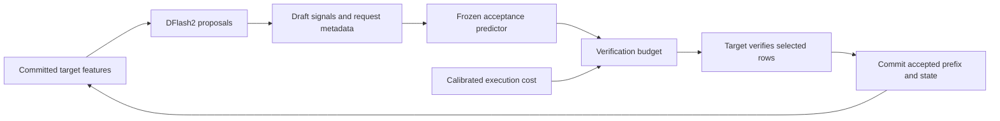

# Research overview

[简体中文](RESEARCH_OVERVIEW.zh-CN.md) | **English** · [Home](../README.en.md) · [All experiments](README.md)

Documentation reviewed on 2026-11-02. Hardware reports extend through E58 (2026-10-28); the linked RSI v2 proposal remains unexecuted.

SparkInfer-Q studies how to allocate inference work on a single NVIDIA DGX Spark. Its current testbed is a quantized Qwen target and a DFlash2 drafter. The central question is whether acceptance prediction and measured execution costs can reduce wasted target verification while preserving the serial target's output and committed state.

## Reading path

| Question | Read the implementation | Inspect the evidence |
| --- | --- | --- |
| What does the predictor learn? | [Feature extraction](../spark_infer_q/confidence_features.py), [training and budget rule](../spark_infer_q/confidence_head.py), [inference](../spark_infer_q/local_policy.py) | [E16 bilingual experiment](E16_BILINGUAL_EXPANSION_REPORT.md), [E17 completed training](E17_COMPLETED_TRAINING_REPORT.md), [released E17 artifact](../results/e17/completed/e17-selected-model.json) |
| How does a prediction become GPU work? | [Speculative runtime](../spark_infer_q/kaifra_speculative.py), [native scheduler wrapper](../spark_infer_q/native_scheduler.py), [greedy verification contract](../spark_infer_q/speculative.py) | [K2 usage](K2_DFLASH_SCHEDULER_USAGE.md), [target Graph study](E29_TARGET_VERIFICATION_REPORT.md) |
| How do requests share work without sharing private state? | [Joint target](../spark_infer_q/kaifra_joint_target.py), [joint runtime](../spark_infer_q/kaifra_joint_runtime.py), [draft projection ownership](../spark_infer_q/draft_projection_cache.py) | [Joint target report](JOINT_TARGET_EXECUTION_REPORT.md), [E54 isolation repair](E54_REQUEST_DRAFT_CACHE_REPORT.md) |
| Where are limitations and unsuccessful experiments recorded? | [CPU tests](../tests), [evidence export scripts](../scripts) | [Themed index](README.md), [E25 online predictor test](E25_ONLINE_COMPARISON_REPORT.md), [E58 compressed-KV gate](E58_NATIVE_CONVERSION_REPORT.md) |

## The decision being learned



The predictor is a small decision component, not the target language model or the DFlash architecture. In the E17 F1 artifact it uses 137 inputs and seven conditional logistic heads, followed by independent probability calibration. Inputs include draft score margins, known request information and a fixed projection of draft hidden states. No current target-verification outcome is used as a feature.

The heads produce cumulative progress probabilities `r[i]`. The single-request budget chooses a verification width `w` by maximizing:

```text
expected emitted tokens(w) / estimated round cost(w)
= (1 + sum(r[:w-1])) / cost_ms[w-1]
```

One row is the pending anchor; the other `w-1` rows are draft tokens. All choices include the already-paid full draft cost, even `w=1`. This is a **post-draft verification decision**: selecting fewer rows does not recover draft work that has already run. Cost estimates also have to account for feature extraction, transfer and predictor execution. See [the implementation](../spark_infer_q/confidence_head.py) and [K2's integration contract](K2_DFLASH_SCHEDULER_USAGE.md).

Cross-request scheduling is a separate layer. It decides which requests can progress and how prefill/decode opportunities are shared. GPU batching goes further by sharing a target forward across requests. Logical scheduler blocks, physical KV storage and private recurrent/draft state have distinct ownership rules.

## What is implemented and what is measured

| Area | Evidence | Boundary |
| --- | --- | --- |
| Learned acceptance budget | E16: 44.08 vs 40.21 decode tok/s against the lagged policy on 20 new bilingual/mixed tasks | Single-request greedy, bounded suite; not a cross-model or production result |
| Further predictor training | E17 passes its independent checks; online gain over E16 is +0.09% with an interval crossing zero | More data did not establish a new speedup; E25's larger MLP also has no confirmed online gain |
| Runtime integration | K2 connects the predictor and current-round budget to the native Scheduler; K3 adds optional target Graph execution | Historical predictor gains cannot be transferred directly to a new runtime's performance |
| Joint target computation | Two requests can share a target forward; the report measures aggregate throughput | This API is target-only; asynchronous DFlash serving remains separate [PR #19](https://github.com/EdwinWang831/spark-infer-q/pull/19) work |
| Long-context ownership | E54 preserves per-request draft projections; two populated 256K adaptive requests match their isolated output, effective state and decision traces | Interleaved research adapter, not batched long-context GPU throughput; no eight-way or 1M result |
| Compressed target KV | E58 validates native conversion against the reference codec | Every compressed candidate still fails the BF16-KV-relative 3% raw-logit-L2 gate; conversion correctness is not model-quality equivalence |

Decode speed, time to first token, full-request latency and aggregate multi-request throughput answer different questions. Gains in separate reports must not be multiplied or used as a current TensorFold ranking. E7 remains the historical matched comparison.

## Run the predictor without a GPU

From the repository root:

```bash
python3 -m examples.adaptive_budget
```

The [example](../examples/adaptive_budget.py) reads the real [released E17 predictor](../results/e17/completed/e17-selected-model.json) and calls the existing `ProgressModel.predict` and `choose_rows` implementations. It uses only Python's standard library, with no downloads or target/draft model loading.

Inputs are explicitly synthetic: training-mean features, zeroed draft score signals, and larger draft margins. Costs are the artifact's historical short-context calibration, including full drafting and predictor costs. The table shows the selected width and **estimated** progress/cost. It does not measure acceptance accuracy, GPU execution, current-machine latency or speedup. The feature extractor itself requires the full prepared GPU environment.

For implementation checks:

```bash
python3 -m unittest discover -s tests -p 'test_confidence_head.py' -v
python3 -m unittest discover -s tests -v
```

Optional PyTorch/NumPy tests skip when those packages are absent. Full model reproduction requires the external sources, checkpoints and prepared environment described in [K2 usage](K2_DFLASH_SCHEDULER_USAGE.md) and the [resident worker guide](RESIDENT_RESEARCH_WORKER.md). Public summaries and small predictor artifacts are committed; raw traces and model weights are not.

## Project work and upstream boundaries

- **This repository:** acceptance labels/features, predictor fitting/calibration, cost-aware budget integration, request/state adapters, prefill orchestration, lifecycle checks and paired evaluation/export tools.
- **Upstream:** the Qwen model, external DFlash2 checkpoint/reference method, DeepInfer C++ Scheduler and MTPVarlen, TensorFold loading/operators, and attributed Mia prefill kernels. See [third-party notices](../THIRD_PARTY_NOTICES.md).
- **Claims to evaluate:** causal decision quality, net end-to-end benefit and state isolation. Adapting these components does not by itself establish an original speculative-decoding algorithm or a backend independent of TensorFold.

## Feedback and RSI

The current predictor is frozen during an experiment. Adaptive width decisions and manual kernel changes do not establish recursive self-improvement.

The [RSI proposal, PR #15](https://github.com/EdwinWang831/spark-infer-q/pull/15) is **PROPOSED v2; EV0–EV7 are unexecuted** as of this documentation review. Its proposed loop is:

```text
usage feedback → candidate policy/configuration → counterfactual replay
→ time-held-out evaluation → paired online confirmation → adopt or roll back
```

Candidates may concern acceptance prediction, draft decisions or request-dependent execution configurations. Output/state correctness, causal feature availability and replay fidelity need independent checks; elapsed time remains a cost estimate until measured. Data collection, search, training, validation and switching overhead must be included in net benefit. EV5 separately proposes improving the evolution procedure from its own history; this is not an implemented capability.

The connection to scientific computing is a constrained decision problem: choose useful computation under latency and memory limits, build a testable cost model, and verify the resulting behavior. The connection to scientific agents is the proposed experiment/feedback/evaluation loop and efficient execution of their model calls. No scientific-agent application, scientific solver or RSI speedup has been demonstrated here.
