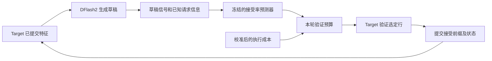

# 研究导览

**简体中文** | [English](RESEARCH_OVERVIEW.md) · [首页](../README.md) · [全部实验](README.md)

文档核对日期：2026-11-02。硬件报告更新到 E58（2026-10-28）；所链接的 RSI v2 仍为未执行方案。

SparkInfer-Q 研究单台 NVIDIA DGX Spark 上的推理计算分配。目前使用量化 Qwen target 和 DFlash2 草稿模型，核心问题是：能否结合接受率预测与实测执行成本，减少无效的 target 验证，同时保持与串行 target 相同的输出和已提交状态？

## 建议阅读顺序

| 想了解的问题 | 对应实现 | 对应证据 |
| --- | --- | --- |
| 预测器学什么？ | [特征提取](../spark_infer_q/confidence_features.py)、[训练与预算规则](../spark_infer_q/confidence_head.py)、[推理](../spark_infer_q/local_policy.py) | [E16 中英文实验](E16_BILINGUAL_EXPANSION_REPORT.md)、[E17 补训结果](E17_COMPLETED_TRAINING_REPORT.md)、[公开 E17 预测器](../results/e17/completed/e17-selected-model.json) |
| 预测怎样变成 GPU 工作？ | [推测运行时](../spark_infer_q/kaifra_speculative.py)、[原生调度封装](../spark_infer_q/native_scheduler.py)、[greedy 验证规则](../spark_infer_q/speculative.py) | [K2 用法](K2_DFLASH_SCHEDULER_USAGE.md)、[target Graph 对照](E29_TARGET_VERIFICATION_REPORT.md) |
| 多请求如何共享计算并隔离私有状态？ | [联合 target](../spark_infer_q/kaifra_joint_target.py)、[联合运行时](../spark_infer_q/kaifra_joint_runtime.py)、[草稿投影所有权](../spark_infer_q/draft_projection_cache.py) | [联合 target 报告](JOINT_TARGET_EXECUTION_REPORT.md)、[E54 隔离修复](E54_REQUEST_DRAFT_CACHE_REPORT.md) |
| 局限和失败结果在哪里？ | [CPU 测试](../tests)、[证据导出脚本](../scripts) | [主题索引](README.md)、[E25 预测器在线对照](E25_ONLINE_COMPARISON_REPORT.md)、[E58 KV 精度门槛](E58_NATIVE_CONVERSION_REPORT.md) |

## 预测器参与什么决策



预测器是一个小型决策部件。语言模型和 DFlash 架构来自上游。E17 的 F1 预测器使用 137 维输入、七个条件 logistic 头及独立概率校准；输入包括草稿分数间隔、已知请求信息和草稿隐藏状态的固定投影，不使用本轮 target 验证结果。

预测器给出各深度仍能推进的累计概率 `r[i]`。单请求预算通过下面的比值选择验证宽度 `w`：

```text
预计产出 token 数(w) / 预计本轮耗时(w)
= (1 + sum(r[:w-1])) / cost_ms[w-1]
```

一行对应尚待处理的 anchor，另外 `w-1` 行对应草稿。所有宽度都要计入已经完成的整段草稿成本，包括 `w=1`。因此，当前策略是**草稿生成后的验证长度决策**，少验证几行不会收回已经花掉的草稿计算。特征提取、传输和预测器执行成本也需要计入。见[预算规则](../spark_infer_q/confidence_head.py)及 [K2 接入契约](K2_DFLASH_SCHEDULER_USAGE.md)。

跨请求调度属于另一个层次：决定哪些请求可以推进，以及怎样分配 prefill/decode 机会。GPU 合批进一步让多个请求共享一次 target 前向。调度器逻辑块、物理 KV 存储、每请求循环状态和草稿状态有不同的所有权边界。

## 已实现与已测量的范围

| 方向 | 已有证据 | 结论边界 |
| --- | --- | --- |
| 学习接受率并分配预算 | E16 在 20 条新中英文/混合任务上，相对滞后策略为 44.08 vs 40.21 decode tok/s | 单请求 greedy、有限任务集，不能外推为跨模型或生产收益 |
| 继续补训预测器 | E17 通过独立检查，但在线比 E16 仅 +0.09%，区间跨零 | 更多数据没有建立新增提速；E25 的较大 MLP 也未确认在线收益 |
| 运行时接入 | K2 把预测器和本轮预算接入原生 Scheduler；K3 增加可选 target Graph | 旧研究循环的预测器收益，不能直接当作新运行时的速度承诺 |
| 联合 target 计算 | 两个请求可以共享 target 前向；报告测量总吞吐 | 该 API 为 target-only；异步 DFlash 服务仍是独立的 [PR #19](https://github.com/EdwinWang831/spark-infer-q/pull/19) 工作 |
| 长上下文所有权 | E54 保留每请求草稿投影，两份已填充 256K 的动态请求与各自独立运行的输出、有效状态和决策轨迹一致 | 交替执行的研究适配器，不是长请求 GPU 合批吞吐；没有八路或 1M 结果 |
| Target KV 压缩 | E58 确认原生转换与参考 codec 一致 | 所有压缩候选仍未通过相对 BF16 KV 的 3% raw-logit-L2 门槛；转换正确不等于模型精度一致 |

Decode 速度、首 token 延迟、完整请求耗时和多请求总吞吐回答不同问题。不能把不同报告的收益相乘，也不能据此推出当前 TensorFold 排名；E7 仍是历史同机对照。

## 无需 GPU 的预测器示例

在仓库根目录运行：

```bash
python3 -m examples.adaptive_budget
```

[示例](../examples/adaptive_budget.py)加载真实的[公开 E17 预测器](../results/e17/completed/e17-selected-model.json)，调用现有 `ProgressModel.predict` 和 `choose_rows`。只使用 Python 标准库，不下载或加载 target/草稿模型。

输入明确是合成特征：训练均值、置零的草稿分数信号，以及增大的草稿间隔。成本来自 artifact 中历史短上下文校准，计入完整草稿与预测成本。输出表展示选定宽度和**预计**产出/耗时，不测接受率准确性、GPU 执行、本机延迟或提速。特征提取器本身仍需要准备好的完整 GPU 环境。

实现检查入口：

```bash
python3 -m unittest discover -s tests -p 'test_confidence_head.py' -v
python3 -m unittest discover -s tests -v
```

缺少 PyTorch/NumPy 时，相应可选测试会跳过。完整模型复现需要 [K2 用法](K2_DFLASH_SCHEDULER_USAGE.md)和[常驻 worker 文档](RESIDENT_RESEARCH_WORKER.md)所述的外部源码、检查点与研究环境。仓库公开脱敏汇总和小型预测器，原始轨迹与模型权重未提交。

## 本项目工作与上游归属

- **本仓库工作：** 接受率标签与特征、预测器训练/校准、成本感知预算接入、请求与状态适配、prefill 编排、生命周期检查和配对评估/导出工具。
- **上游工作：** Qwen 模型、外部 DFlash2 检查点与参考方法、DeepInfer C++ Scheduler/MTPVarlen、TensorFold 加载与算子、保留署名的 Mia prefill 内核。见[第三方说明](../THIRD_PARTY_NOTICES.md)。
- **需要评估的主张：** 因果决策质量、完整执行净收益和状态隔离。接入这些部件本身不构成原创投机解码算法或独立于 TensorFold 的底座证明。

## 运行反馈与 RSI

目前预测器在每轮实验中保持冻结。动态宽度决策和人工内核优化，不构成递归自我改进的证据。

截至本次文档核对，[RSI 方案 PR #15](https://github.com/EdwinWang831/spark-infer-q/pull/15)为 **PROPOSED v2，EV0–EV7 均未执行**。拟议闭环为：

```text
使用反馈 → 候选策略/执行配置 → 反事实回放
→ 时间留出评估 → 在线配对确认 → 晋升或回滚
```

候选可涉及接受率预测、草稿决策或按请求选择执行配置。输出/状态正确性、因果特征可用性与回放保真度需独立验证；未实测前，耗时仍是成本估计。数据采集、搜索、训练、验证和切换开销要计入净收益。EV5 另行提议利用历史记录改善进化过程自身，目前也未实现。

与科学计算的联系在于约束下的决策：在延迟和内存限制内选择有价值的计算，建立可检验的成本模型，并验证行为。与科研智能体的联系在于拟议的实验、反馈、评估闭环及其模型调用的高效执行。仓库尚未验证科研智能体应用、科学问题求解器或 RSI 提速。
